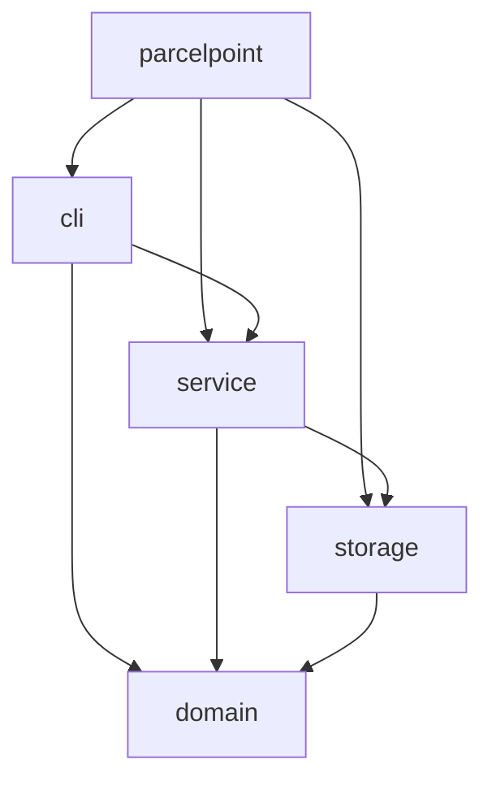
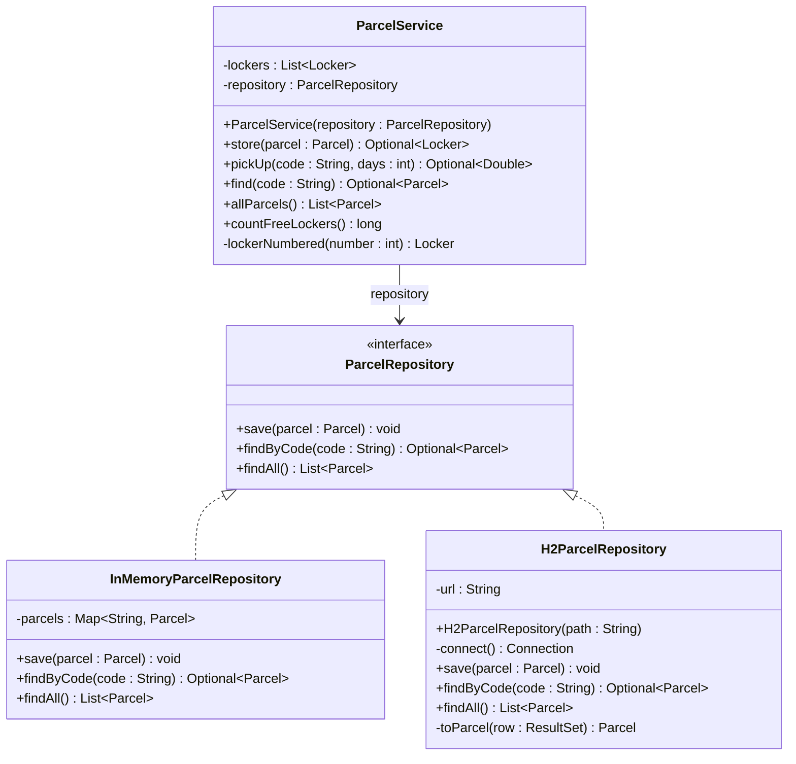
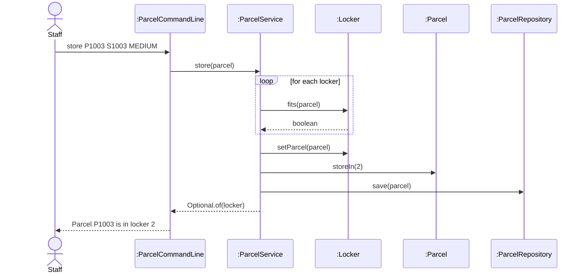

# Lab Report, Designing the Data Management Layer with H2

Repository URL: https://github.com/Patharapol2548/itcs382-h2-lab.git

## Tools

| Item | Version or name |
| --- | --- |
| JDK | 27 |
| Maven | 3.10.0 |
| IDE | Antigravity IDE |
| AI tool and exact model, if you used one | Google Antigravity, Gemini 3.8 flash |

## Part 0. From a store in memory to H2

Commit of the starter, before any change: `68879ac9ed8501a8b2cfd501e4a0b4b88df401a9`

0.3 Your prediction for `staff`, written before the second run: 

`ANSWER:` All previously stored parcels will disappear and `staff` will show 3 free lockers because the data was only kept in temporary in-memory storage.

Output of the second run, for `staff` and `quit`:

```text
> staff
Free lockers: 3
> quit
```

State in one sentence where you think the parcels of the first run were kept.

`ANSWER:` The parcels of the first run were kept in volatile Java heap memory inside a `LinkedHashMap`, which was discarded when the JVM process terminated.

0.5 The line of Main that you would change to keep the parcels somewhere else:

```java
ParcelRepository repository = new InMemoryParcelRepository();
```

0.6 Commit of the switch to H2: `730deb3`

0.7 Output of `SELECT * FROM PARCEL;` after you stored two parcels:

```text
CODE  | STUDENT_ID | PARCEL_SIZE | STATUS | LOCKER_NUMBER
P1001 | S1001      | SMALL       | STORED | 1
p1002 | S1002      | LARGE       | STORED | 3
(2 rows, 16 ms)
```

0.8 Explain why ParcelPoint could not start while the H2 Shell was open, and identify the class that wrote the message `Cannot create the PARCEL table`. 

`ANSWER:` Because the database file was locked by the H2 Shell, the application could not access the data store. 
The class that wrote the message `Cannot create the PARCEL table` is H2ParcelRepository(in its constructor, cathing SQLException and Throwing IllegalStateException).

0.9 Explain why `staff` shows no parcel while `find` shows each one, and why all three lockers look free.

`ANSWER:` When staff is called, it uses `ParcelService.allParcels()`, which then calls `H2ParcelRepository.findAll()`. However, `findAll()` is not implemented yet, so it just returns an empty list (`List.of()`).

Also, when `ParcelService` is created, it checks `repository.findAll()` to see which lockers are already occupied. But because the list is empty, it does not find any occupied lockers. That's why all 3 lockers show as available.

0.11 Your findAll method:

```java
@Override
    public List<Parcel> findAll() {
        String sql = "SELECT * FROM PARCEL ORDER BY CODE";
        List<Parcel> parcels = new ArrayList<>();
        try (Connection connection = connect();
             PreparedStatement statement = connection.prepareStatement(sql);
             ResultSet row = statement.executeQuery()) {
            while (row.next()) {
                parcels.add(toParcel(row));
            }
            return parcels;
        } catch (SQLException e) {
            throw new IllegalStateException("Cannot read the parcels", e);
        }
    }

    private Parcel toParcel(ResultSet row) throws SQLException {
        return new Parcel(
                row.getString("CODE"),
                row.getString("STUDENT_ID"),
                ParcelSize.valueOf(row.getString("PARCEL_SIZE")),
                ParcelStatus.valueOf(row.getString("STATUS")),
                row.getObject("LOCKER_NUMBER", Integer.class));
    }
```

Commit that adds findAll: `eaa30b4`

0.12 Output of `SELECT * FROM PARCEL;` after the pickup:

```text
CODE  | STUDENT_ID | PARCEL_SIZE | STATUS    | LOCKER_NUMBER
P1001 | S1001      | SMALL       | PICKED_UP | null
p1002 | S1002      | LARGE       | STORED    | 3
(2 rows, 25 ms)
```

0.13 Optional. Describe what `find P9999'OR'1'='1` showed while the SQL was joined from strings, and what it showed after you put the placeholder back.

`ANSWER:` When string concatenation was used (WHERE CODE = '" + code + "'), typing find P9999'OR'1'='1 caused SQL injection because '1'='1' evaluated to true for every record, returning the first stored parcel (P1001). After restoring the ? placeholder with PreparedStatement.setString(1, code), the entire string was treated as a literal parcel code rather than executable SQL, returning No parcel with code P9999'OR'1'='1.

## Part A. Model the design

A1 Complete the flowchart with one node for each package and one arrow for each dependency, from the package that uses to the package that is used. Mark the package that accesses the data store.



State whether cli depends on storage, and explain why. 

`ANSWER:` No, `cli` does not depend on `storage`. `ParcelCommandLine` only imports classes from `parcelpoint.domain` and `parcelpoint.service`. It interacts with `ParcelService` for all application actions and never directly references or imports `ParcelRepository` or any storage implementation.

A2 Complete the class diagram of the data management layer with ParcelService, the interface ParcelRepository with its three operations, and the two classes that implement it.



A3 Draw a sequence diagram for the command `store P1003 S1003 MEDIUM`, from the staff member to the repository. Show each message as an operation of the class that receives it.



Explain why the last lifeline is the interface ParcelRepository rather than H2ParcelRepository.

`ANSWER:` The last lifeline is the interface `ParcelRepository` because `ParcelService` adheres to the Dependency Inversion Principle; it depends exclusively on the abstraction (`ParcelRepository` interface) rather than any concrete implementation class. From `ParcelService`'s perspective, it sends the `save(parcel)` message to the interface reference, completely decoupled from whether `InMemoryParcelRepository`, `H2ParcelRepository`, or any future storage provider executes it.

## Part B. Design questions

1. Identify the files that you changed to move from the store in memory to H2, and explain why no other class had to change. Use the terms of this course.
    - To move from in-memory storage to H2 is in Main.java and had to be change by writing the inmplement FindAll in H2ParcelRepository.java
2. The PARCEL table stores the size of a parcel as SMALL, MEDIUM or LARGE rather than as 1, 2 or 3. Identify the type of connascence between ParcelSize and the table in each case, and explain which one is weaker.
    - Using SMALL, MEDIUM, and LARGE creates Connascence of Name (CoN), while using 1, 2, and 3 creates Connascence of Meaning (CoM). Connascence of Name is weaker because names are easier to understand and less likely to cause mistakes.

3. Project Phase 2 asks for a data store that needs no separate server. Explain why an embedded database such as H2 meets this rule, and describe the limit of an embedded database that Step 0.8 showed.
    - H2 is an embedded database that runs inside the application's JVM without needing a separate database server. However, Step 0.8 showed that H2 locks its database file while in use, so another program cannot access the same file at the same time.

4. State the data store that you would choose for your Project Phase 2 team, files or an embedded database, the requirement that drives the choice, and the package that will access it.
    - I would choose an embedded database (H2) because it meets the requirement of not needing a separate database server. The repository package will be responsible for accessing and managing the database.
    
## AI usage declaration

| AI tool and exact model | Date | Purpose | Files or answers it produced or changed | How you checked its output |
| --- | --- | --- | --- | --- |
| Google Antigravity, Gemini 3.8 Flash | 2026-11-14 | Lab guidance, Mermaid Diagram Assiting | LAB_REPORT.md, H2ParcelRepository.java | Verified by running mvn package, testing commands in terminal, checking H2 shell outputs, and validating Mermaid syntax |
